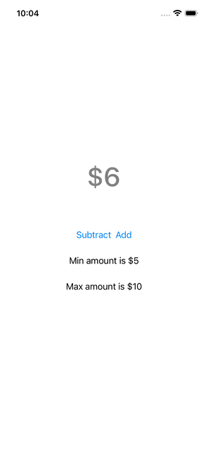

<h1 align="center">UnionNumbers</h1>
<h3 align="center">A SwiftUI package for animated numbers.</h3>
<p align="center">
    
</p>

<br/>
## Features

- Configurable minimum and maximum thresholds
- Disabled/shaking state when number goes above/below thresholds

## Get Started

1. Install **UnionNumbers** from Swift Package Manager  
   `https://github.com/unionst/union-numbers`

2. Add `numberCounting` into your view hierarchy

```swift
import SwiftUI
import UnionNumbers

struct ContentView: View {
    @State private var amount: String = "0"
    @State private var shake = false
    @State private var min: Decimal = 10
    @State private var max: Decimal = 1900
    
    private let step: Double = 1.50

    private func adjust(by delta: Double) {
        let current = Decimal(string: amount) ?? 0
        let result = current + Decimal(delta)
        amount = "\(result)"
    }
    
    var body: some View {
        VStack {
            Text("Placeholder")
                .numberCounting(amount)
                .animationStyle(
                    $amount,
                    shake: $shake,
                    min: $min,
                    max: $max
                )
                .currency(.USD)
                .font(.system(size: 50, weight: .medium), size: 50)
                .foregroundColor(
                    Color(
                        red: 0.5,
                        green: 0.5,
                        blue: 0.5
                    )
                )
                .monospacedDigit()
                .padding(.bottom, 50)
            
            HStack {
                Button("Subtract") {
                    adjust(by: -step)
                }
                
                Button("Add") {
                    adjust(by: step)
                }
            }
        }
        .padding()
    }
}

#Preview {
    ContentView()
}
